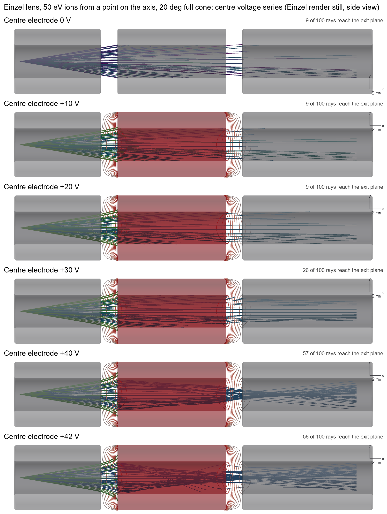
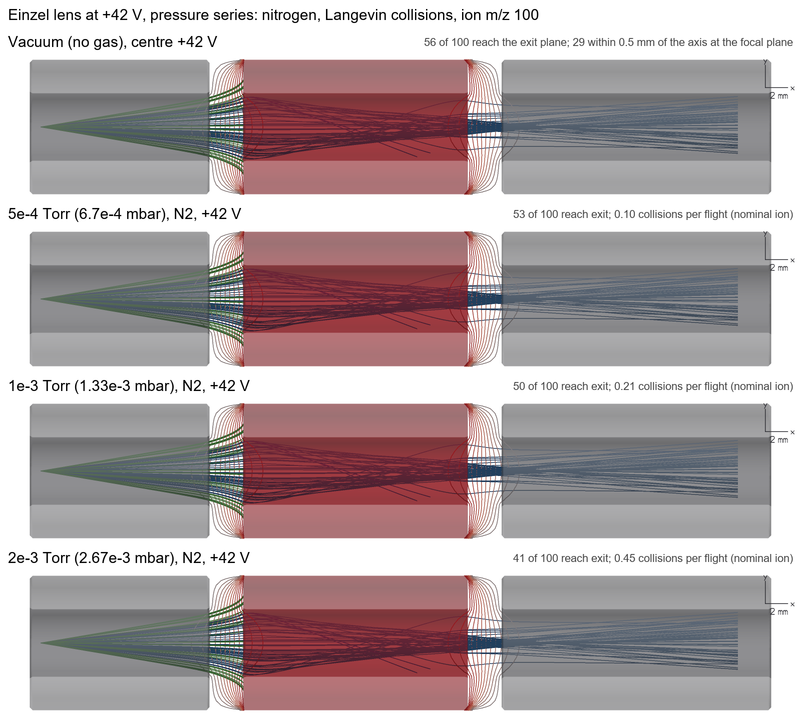

# Gallery: an einzel lens, voltage and pressure series

This page reproduces the *behaviour* shown in two figures on a public teaching page about
einzel lenses (Mass Spec Pro, "Einzel Lens",
<http://www.massspecpro.com/technology/ion-optics/einzel-lens-0>) with Einzel's own solver and
renderer. It is a qualitative reproduction, not a numerical match. The source gives no
dimensions, no ion mass, no gas species and no software, so every one of those is a choice made
here and is listed below. None of the source's images is used.

What the two source figures show, in words:

- **Focusing.** A three-cylinder einzel lens, outer two electrodes at 0 V and the centre at
  Vc = 0, +10, +20, +30, +40 and +42 V. A 50 eV positive-ion beam leaves a point on the axis at
  the lens entrance with a 20 degree angular spread. At 0 V the beam diverges and strikes the
  walls; near +30 V it is roughly collimated; at +40 V it converges; at +42 V it is refocused to
  a crossing just past the exit. As the potential difference approaches the beam energy,
  focusing improves.
- **Pressure.** The +42 V case with no gas, then at 5e-4, 1e-3 and 2e-3 Torr. As pressure rises,
  collisions scatter ions and the focus degrades.

## The mechanism, paraphrased

A positive centre voltage below the beam energy slows the ion in the middle tube. Leaving the
first tube the ion meets a field that slows it and pushes it away from the axis. Inside the
centre tube the field is nearly zero and the ion is slow. Entering the third tube it is pushed
away from the axis again as it speeds back up. The net effect is inward, because the ion spends
longer in the half of the field that pulls it toward the axis (it is slow there) than in the
half that pushes it out. Raising the centre voltage toward the beam energy makes the ion slower
in the middle, so the lens gets stronger and the focus moves toward the lens. The ion leaves
with the energy it entered with, since both end tubes are at 0 V. (Paraphrased from the page
cited above; the model's own `description`, from `einzel templates einzel-lens`, says the same.)

## What was modelled, and what was chosen

Everything below that the source does not state is a choice. None of it was tuned to match a
number in the source, because the source has none; the geometry was adjusted until the series
showed the published *sequence* inside one frame.

| Item | Value used | Why |
| --- | --- | --- |
| Template | `einzel-lens`, axisymmetric half-plane solve, x is the axis, y the radius | The shipped lens; no new code |
| Bore radius | 3 mm (all tubes) | Small enough that a 10 degree ray hits a wall inside the lens at 0 V, as the source shows |
| Tube lengths | entrance 16, centre 20, exit 24 mm; gaps 3 mm | Chosen so the +42 V focus falls shortly past the entrance of the exit tube and the 0 V beam is lost on walls |
| Wall thickness | 3 mm | Template parameter; only the gaps let field out |
| Mesh | 24 cells per bore radius (0.125 mm) | Template default |
| Beam | 50 eV, singly charged, m/z 100 | Source gives no mass. In vacuum the mass does not change a trajectory |
| Source | one point on the axis, 1 mm inside the entrance tube (x = 1 mm) | "A point on the axis at the lens entrance". It cannot sit at x = 0 because that is the solve domain's grounded edge |
| Angular spread | `source.cloud.divergence` = 10 degrees | **Divergence is the half-angle of a cone, so 10 degrees is the 20 degree full cone** the source states. Directions are uniform in solid angle inside the cone, not Gaussian |
| Rays | 100, seed 7, temperature 0 K, `population` 1 | Zero temperature so the only spread is the cone. `population` 1 because 100 rays from a point are not a charged bunch (see the warnings below) |
| Centre voltage | 0, 10, 20, 30, 40, 42 V | As in the source |
| Gas (pressure series) | nitrogen, 300 K; 5e-4, 1e-3 and 2e-3 Torr entered as 6.666e-4, 1.3332e-3 and 2.6664e-3 mbar (0.0667, 0.1333, 0.2666 Pa) | Source gives no gas; N2 is the usual choice |
| Collision model | main series: `hardSphere`, cross section 80 square angstroms. Second series: `langevin`, polarizability 1.74 cubic angstroms | See "Which collision model" below |
| Gas seed | 2026 | Reproducibility |

The cone is the part of the source's setup Einzel expresses directly: there is no separate
Gaussian angular-spread setting, by design; the cloud's `divergence` is the cone.

## Commands

From a fresh project (`einzel init gallery`, then `cd gallery`), copy
`docs/figures/gallery-einzel-lens-build.py` into it. It starts from `einzel new ... --from-template
einzel-lens` and writes the twelve models used. Two of them are kept in this repository as they
ran: `docs/figures/gallery-einzel-lens-vacuum-42V.json` and
`docs/figures/gallery-einzel-lens-1e-3-torr.json`.

```
python gallery-einzel-lens-build.py
einzel validate models/f42.json
einzel run models/f42.json --json
einzel render still models/f42.json --view side --see-through --height-px 300 --width-px 1600 --out panels/f42.png
```

The same `run` and `render still` commands apply to every `models/f<V>.json` and
`models/p_<model>_<Torr>.json`. `render still` draws the viewport's bundle of paths, one per ray;
`render section` draws only the single nominal ion, so it is not used here. The two sheets are
the panels stacked and labelled with Pillow; the trajectories are Einzel's own and nothing is
redrawn.

## Figure 1: focusing



Measured per panel. "Reach exit plane" counts rays arriving at the detector plane, 3 mm before
the end of the exit tube (x = 63 mm), within the 3 mm bore; the rest are lost on the electrode
named. "Slope" is how fast the rms radius of a separate narrow cone (1.5 degree half-angle, so
nearly paraxial) changes along the exit tube, in mm per mm: positive is diverging, negative
converging. The paraxial focus is where that rms radius reaches zero, measured as the
intersection of straight-line fits to the radius either side.

| Centre | Reach exit plane (of 100) | Lost on | rms radius at exit plane (survivors) | Slope, narrow cone | Paraxial focus, past the entrance of the exit tube |
| --- | --- | --- | --- | --- | --- |
| 0 V | 9 | centre 75, exit 16 | 2.32 mm | +0.0156 | none, diverging |
| +10 V | 9 | centre 77, exit 14 | 2.24 mm | +0.0143 | none, diverging |
| +20 V | 9 | centre 77, exit 14 | 1.91 mm | +0.0097 | none, still diverging |
| +30 V | 26 | centre 74 | 1.55 mm | about 0 (radius constant to 0.002 mm over 20 mm) | collimated |
| +40 V | 57 | centre 42, exit 1 | 1.39 mm | -0.0158 | 14.1 mm |
| +42 V | 56 | centre 44 | 1.81 mm | -0.0185 | 7.0 mm |

Reading it against the source:

- **0 V, divergence and wall loss: reproduced.** 91 of 100 rays strike a tube.
- **+30 V, roughly collimated: reproduced.** The narrow cone neither grows nor shrinks, and the
  survivors of the wide cone fall from 2.3 mm rms to 1.55 mm.
- **+40 V, converging: reproduced.** Crossing 14.1 mm into the exit tube.
- **+42 V, refocused to a crossing just past the exit: partly.** The crossing moves in toward the
  lens (14.1 mm to 7.0 mm), which is the published trend, and it lies 7 mm (2.3 bore radii) past
  the entrance of the exit tube. Whether that is "just past the exit" depends on how long the
  source's exit tube is, which it does not say. The 10 degree cone is not a point focus: the rms
  radius at the focal plane is 0.9 mm, because outer rays focus shorter than inner ones
  (spherical aberration).
- **Most rays are lost at every voltage.** Transmission peaks near 57 percent at +40 V; 44 rays
  at +42 V strike the centre tube. The source's drawing shows a larger share getting through. A
  larger bore relative to the beam would pass more, at the price of a weaker lens in the same
  length; this was not scanned.
- The rms radius at the exit plane is smallest at +40 V and larger at +42 V because the plane
  at x = 63 mm is already well beyond the +42 V focus, so that beam is spreading again.

## Figure 2: pressure, +42 V


What the engine reports for each pressure (`einzel run --json`, the `regime` block and the
ensemble). "Collisions per flight" is the engine's figure for the nominal on-axis ion; the
ensemble totals are over all 100 rays. Hard-sphere series, 80 square angstroms:

| Pressure | Mean free path | Knudsen number (aperture 6 mm) | Collisions per flight | Ensemble collisions / ions scattered | Reach exit plane (within the 3 mm bore) | Lost on | Within 0.5 mm of axis at the focal plane, x = 49 mm |
| --- | --- | --- | --- | --- | --- | --- | --- |
| vacuum | - | - | 0 | 0 / 0 | 56 | centre 44 | 29 of 100 |
| 5e-4 Torr (6.67e-4 mbar) | 77.7 mm | 12.9 | 1.18 | 85 / 38 | 32 | centre 46, entrance 13, exit 7, 2 still in flight at the 1 ms limit | 19 of 100 |
| 1e-3 Torr (1.33e-3 mbar) | 38.8 mm | 6.47 | 2.40 | 323 / 60 | 20 | centre 40, entrance 20, 10 still in flight, exit 8 | 10 of 100 |
| 2e-3 Torr (2.67e-3 mbar) | 19.4 mm | 3.24 | 3.45 | 593 / 79 | 14 | entrance 37, centre 31, 12 still in flight, exit 4 | 4 of 100 |

The last column came from separate runs with the detector moved to x = 49 mm, the focal plane.
The rms radius of survivors is not a useful figure for the gas runs: scattered ions are mostly
lost, so what remains is selected for being unscattered.

Second series, `langevin` collisions (the model `docs/pressure.md` assigns to this pressure
range):



| Pressure | Mean free path | Knudsen number | Collisions per flight | Ensemble collisions / ions scattered | Reach exit plane | Within 0.5 mm of axis at x = 49 mm |
| --- | --- | --- | --- | --- | --- | --- |
| 5e-4 Torr | 924 mm | 154 | 0.098 | 5 / 5 | 53 | 28 |
| 1e-3 Torr | 462 mm | 77 | 0.207 | 28 / 12 | 53 | 26 |
| 2e-3 Torr | 231 mm | 38.5 | 0.446 | 112 / 25 | 48 | 21 |

Reading it against the source:

- **Focus degrades with pressure: reproduced with hard spheres, weakly with Langevin.** With hard
  spheres the number of rays within 0.5 mm of the axis at the focus falls 29, 19, 10, 4 as the
  pressure goes 0, 5e-4, 1e-3, 2e-3 Torr, and transmission 56, 32, 20, 14 percent. With Langevin
  capture the same quantities go 29, 28, 26, 21 and 56, 53, 53, 48: the ordering is right and the
  effect is small.
- **Which collision model.** Langevin capture is the model for slow ions in a gas, and the engine
  places it at 1e-5 to 1e-2 mbar. This ion is at 50 eV, about 11 eV in the centre of mass with
  nitrogen, well above where polarization capture sets the cross section, and Langevin gives 0.1
  to 0.45 collisions per flight with a mean free path several times the 72 mm lens. A hard-sphere
  cross section of 80 square angstroms (an assumed, typical geometric cross section for an
  m/z 100 ion; no measured value is behind it) gives 1.2 to 3.5. Hard spheres are documented as
  the vacuum, residual-gas model, and the engine says so on every such run
  (`regime.model-below-validity`), so the main figure rests on a model used outside its stated
  range. Both series are shown so the reader can see how much depends on that choice.
- **A lighter gas.** One run with helium (Langevin, polarizability 0.205 cubic angstroms, mass 4)
  at 1e-3 Torr, 60 rays: 4 collisions in total and 32 of 60 reach the exit plane against 33 of 60
  in vacuum, so helium shows no visible degradation here. Not tabulated further.
- **Scattering shows less in the pictures than in the numbers.** An m/z 100 ion hitting a 28 Da
  molecule is deflected by at most about 16 degrees, usually much less; most of the damage is rays
  pushed into a tube wall (the loss columns), not a smeared focus. The pictures show thinner
  bundles and a ragged crossing, less dramatic than a lighter ion or a heavier gas would give.

## Warnings the engine printed, verbatim codes

Collected from the runs on this page.

- `mesh.node-on-shared-face` (Qualified) appeared on a first geometry (5 mm bore, 20 mm
  entrance) and went away with the final dimensions, so it is not in the data above. It is a
  geometry coincidence, not a physics problem; `einzel solve` explains it.
- `ENSEMBLE_INCOMPLETE` and `ENSEMBLE_SMALL` (Qualified): fewer rays arrive than were launched and
  the arrival-time peak describes the survivors. True, and irrelevant to a trajectory picture.
- `spacecharge.point-packet` (ValidityViolation) appears if `population` is left at its default
  with many rays from one point. Setting `population` to 1 removes it.
- Vacuum series, final geometry: `convergence.at-resolution` at 0 V and
  `CONVERGENCE_ORDER_BELOW_NOMINAL` at +20 and +40 V; none at +10, +30 and +42 V.
- Gas series: `collisions.single-ion-interval` (Qualified, every run), `regime.overlap-band`
  (Qualified; 1e-3 and 2e-3 Torr, both models), `regime.model-below-validity` (Qualified; every
  hard-sphere run), `ENERGY_DRIFT_EXCEEDS_BUDGET` (ValidityViolation; every hard-sphere run and
  Langevin at 1e-3 and 2e-3 Torr, relative drift of order 0.5) and `TRAJECTORY_INCOMPLETE`
  (hard sphere, 2e-3 Torr).

The energy-drift violation cannot mean in a gas what its message says: a collision legitimately
changes the ion's energy. It is reported because the nominal ion was scattered. Treat it as
noise on these runs.

## Rough edges met while building this

- **The detector plane has no aperture.** An ion scattered out through a gap between tubes
  leaves the solve domain, flies on in a straight line and is counted as arrived when it crosses
  the detector plane, at a radius of tens of millimetres (rms radii of 57 to 134 mm appeared at
  1e-3 and 2e-3 Torr before the cut). The tables above count only rays arriving within the 3 mm
  bore. The engine's own `arrived` number includes those escapees (2 of 22 and 2 of 16 in the
  hard-sphere 1e-3 and 2e-3 Torr runs).
- **Ions "still in flight at the time limit".** 10 to 12 of 100 rays at 1e-3 and 2e-3 Torr (hard
  spheres) are neither lost nor arrived after 1 ms. Not investigated; the cause is not
  established.
- **`render section` draws one ion.** Use `render still` for a bundle.
- **The regime numbers (mean free path, Knudsen, collisions per flight) are in `--json` only**,
  not in the terminal summary of `einzel run`.

## Caveat on the scattered panels

A project review on 2026-11-14 found that per-ion collision random streams are seeded
consecutively and are correlated (SPEC.md, review item R0). The scattered panels are
qualitatively right, but ensemble statistics in gas (transmission, scattered counts, the share
within 0.5 mm of the axis) should not be quoted as results until that is fixed. The vacuum
series is not affected: with no collisions there is no random stream, and the rays come from the
cloud seed, not the gas seed.

## What is an assumption and what is a result

Results: the vacuum trajectories and the voltage-series numbers; the regime numbers for the
stated gas model and cross section; the loss itemisation. Assumptions: every dimension, the ion
mass, the gas species, the 80 square angstrom cross section, the 20 degree full cone, and that a
point source one millimetre inside the entrance represents "a point at the lens entrance".
Nothing here is compared quantitatively with the source, which gives no numbers to compare with.
